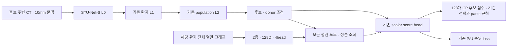

# v3.0 — v2.5 + 환자 전체 혈관 그래프

**MonoPlace3D·MDN·위치 분포 loss는 사용하지 않는다.** v2.5의 공식 STU-Net-S,
L1/L2, P/U 순위 loss, 10mm 문맥과 네 커리큘럼을 유지한다.



혈관은 종양 주변 10mm로 자르지 않는다. 간 내부에서 추출한 모든 centerline 점·native edge·
분리된 성분을 보존한다. 두 층 message passing 뒤, 후보는 환자 전체 노드와 성분을 attention으로
조회한다. 전체 평균 표현도 포함하므로 멀리 떨어진 성분의 정보까지 score에 전달된다.
기존 L2의 population prototype 그래프를 혈관으로 교체하지 않는다.

한 physical patient batch는 disjoint graph 하나로 처리한다. 혈관 encoder는 같은 forward에서
환자당 한 번 계산하고 모든 후보가 공유한다. 좌표는 실제 CT affine으로 native XYZ에서 RAS mm로
변환한다. 정적 CPU 그래프만 캐시하고, 학습된 혈관 embedding은 update마다 다시 계산한다.

현재 혈관 입력은 TotalSegmentator `liver_vessels`의 이진 마스크를 기반으로 한다.
혈관 종류·혈류 방향·multiphase 정보를 임의로 붙이지 않는다. 원본 종양과의 overlap 통계는
모델 입력에서 제외한다. 모든 그래프 연결의 검사는 해부학적 정확도 검증을 대신하지 않는다.

| 항목 | 고정 계약 |
|---|---|
| CT/분할 | 전체 131명, outer 105/26, inner 84/21 |
| 순위 학습 | 65명·527P, 첫 epoch부터 모든 P, P를 다른 P의 음성으로 사용하지 않음 |
| 검증 | 전체 21명, P 없는 5명도 forward, 순위 평균은 적격 16명 |
| 문맥 | footprint 밖 0<거리≤10mm, 간 깊이>1mm, 간 밖 제외 |
| L0 | 공식 pretrained STU-Net-S encoder 6 stages, fine-tuning |
| L1/L2 | 각 2층, 128D, 4head, 기존 연산 유지 |
| 혈관 | 2층, 128D, 4head, 모든 점·edge·성분, 반경/위치/관계 입력 |
| loss | mean U softplus(U−P), mean P, mean patient + 0.1 두 view consistency |
| 학습 | fresh seed42 AdamW 1e−4, 40epochs, B4/accum1, 17 updates/epoch·680 total |
| calibration | B4/B8 × chunk32/64/128 × 3회; B8은 용량 비교, 최종 B4 계약 유지 |
| BEST | 고정 전체 P+128U validation만 사용 |
| CP | 완료된 자체 BEST, 기존 642개 source·각 128개 후보 순서와 paste 계약 유지 |

P는 실제 관측된 종양 위치이고 U는 미관측 비교 위치다. CP 적합/부적합의 GT로 재해석하지 않는다.

## 파일과 실행

- [실행](../../tools/run_v30.py), [설정](../../config/v30.json), [v2.5 문맥](../../hiercp_v1x/v25_context.py), [커리큘럼](../../hiercp_v1x/v25_targets.py)
- [혈관 입력](../../hiercp_v1x/v30_vessels.py), [모델](../../hiercp_v1x/v30_model.py), [배치 scorer](../../hiercp_v1x/v30_scorer.py), [학습](../../hiercp_v1x/v30_training.py)
- [실제 CT 입력/캐시](../../hiercp_v1x/v30_factory.py), [정적 전처리 재사용](../../hiercp_v1x/v30_preparation.py), [CP score 연결](../../hiercp_v1x/v30_cp.py)

```bash
python versions/v3.0/run.py --help
```

`--gpu`는 현재 머신의 물리 GPU 번호 하나다. 서버 이름·GPU UUID·SSH를 코드에 고정하지 않는다.
`--arm A|B|C|D` 중 하나만 실행하며 다른 arm을 시작하지 않는다.
`--mode pipeline`은 정적 prepare → 실제 full128 calibration → 전체 학습 순서다.
동일 output으로 재실행하면 검증한 자신의 latest checkpoint에서 이어간다.
네 arm을 병렬 실행할 때는 공유 입력을 `--mode prepare`로 먼저 한 번 완성한 뒤,
각 arm에서 `--mode calibrate`와 `--mode train`을 실행한다. 공유 정적 준비 lock과 arm별 학습 lock은 별개다.
학습과 각 검증 phase는 환자 수·진행률·partial MRR/top1/pair-win을 출력하고,
phase 완료 시 전체 지표를 출력한다. P가 없는 초기 partial batch는 지표를 undefined로 표시한다.

`--native-experiment`는 기존 sealed native 실험, `--inventory`는 전체 native 관측 목록,
`--stunet-checkpoint`는 공식 `small_ep4k.model`, `--vessels`는 전체 131개 그래프 index다.
`--input-cache`는 **새 v3 전용 공유 경로**, `--output`은 **arm별 별도 경로**를 지정한다.
권장 짧은 경로는 `experiments/v3/input`, `experiments/v3/A`~`D`다.
기존 v2.4 cache와 trained checkpoint는 context/모델이 달라 재사용하지 않는다.

전체 혈관 파일과 CT는 Git에 넣지 않는다. 기존 CT는 inventory 경로를 사용하며,
혈관 index·각 case의 graph.json/centerline_graph.npz를 서버에서 접근할 수 있어야 한다.
CT·혈관·좌표가 없거나 다르면 명확히 실패하며 가짜 graph나 CPU fallback을 만들지 않는다.

`--mode score-cp`는 학습 완료된 자체 BEST만 읽는다. 추가로 기존 `--source-bank`와
`--baseline-preprocessed`가 필요하다. 새 점수 overlay를 만들며 원본 bank·paste 조건을 수정하지 않는다.
이 단계는 nnU-Net의 장기 학습 또는 품질 평가를 대신하지 않는다.

## 검증 상태

검사 기록은 [UNIT](../../validation/v3/unit.json), [전체 131명 혈관](../../validation/v3/vessels.json),
[실제 CT CUDA DEBUG](../../validation/v3/cuda.json)에 보존한다.
최종 UNIT·버전 탐색 회귀검사 104개가 모두 통과했다. 검사 동안 기록한 소스 SHA도 유지됐다.
전체 혈관 입력은 177,212점·347,146방향 edge·7,658개 성분이며 파일 SHA·CT affine·연결을 확인했다.
이는 segmentation의 해부학적 품질을 새로 검증했다는 뜻은 아니다.

CUDA DEBUG는 서로 다른 실제 donor/recipient에서 1P+128U를 모두 채점했다.
실제 혈관 1,226점·2,370방향 edge·54성분을 모두 사용했다.
전체 모델은 14,080,208개 parameter이고 혈관 추가분은 748,416개다.
한 번의 별도 DEBUG update는 1P+7U를 사용했으며 STU·L1·L2·혈관의 gradient와 실제 가중치 변경을 확인했다.
원래 paste gate를 통과한 private CT 복사본에 2,313 voxel을 붙이는 실행 연결도 확인했다.
원본 CT·주석·가중치는 변경하지 않았다.

이 DEBUG의 prototype bank는 donor의 실제 24 region에서 만든 16개로 한정되어 있다.
해당 점수나 paste 위치는 학습된 추천으로 해석할 수 없다.
chunk32/64 검사는 첫 실행과 warm 실행이 섞여 있으므로 production batch 선정 근거로 사용하지 않는다.
**v3.0 전체 학습·전체 순위 평가·전체 642 source CP·nnU-Net 비교는 아직 실행하지 않았다.**
성능 개선은 미검증이다. A6000의 production B4/chunk 처리량은 서버 calibration 후에만 보고한다.

## 작업 완료 체크리스트

- [x] 서버 또는 원격 세션 종료 위험이 있는 명령을 사용하지 않았다.
- [x] 사용자 파일과 기존 결과를 파괴적으로 변경하지 않았다.
- [x] 모델 깊이와 너비를 편의상 축소하지 않았다.
- [x] 그래프와 데이터 규모를 편의상 축소하지 않았다.
- [x] 숨겨진 subset, cap, fast mode를 추가하지 않았다.
- [x] physical batch size와 병렬화 가능성을 검토하고 production 측정 절차를 구현했다.
- [x] 로컬 GPU, CPU, RAM을 확인했다. 서버 자원·throughput은 실행 시 측정한다.
- [x] activation checkpoint·chunking·immutable cache를 사용하며 모델 축소 fallback을 두지 않았다.
- [x] 디버그 설정과 최종 설정을 분리했다.
- [x] dummy, placeholder, random fallback을 사용하지 않았다.
- [x] 핵심 혈관 모듈이 forward, loss, gradient와 optimizer에 연결됨을 UNIT와 실제 CT CUDA DEBUG에서 검사했다.
- [x] 실제 실행 설정과 변경 사항을 명확하게 보고했다.
- [x] smoke test와 전체 학습 또는 전체 평가를 구분해서 보고했다.
